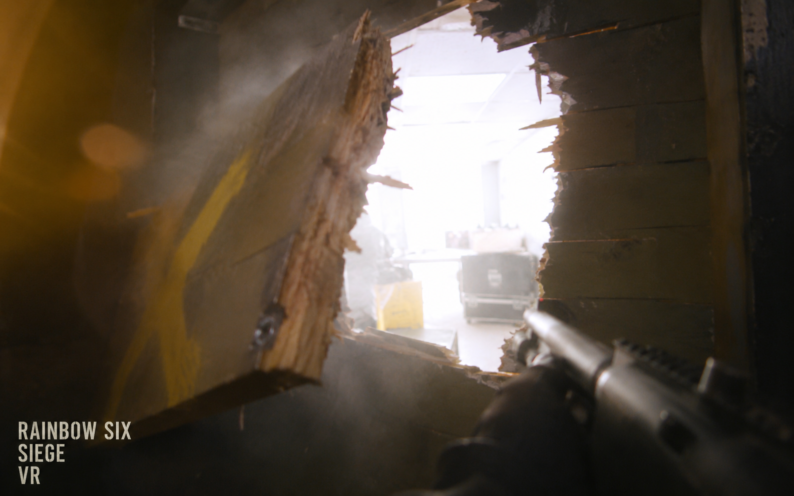
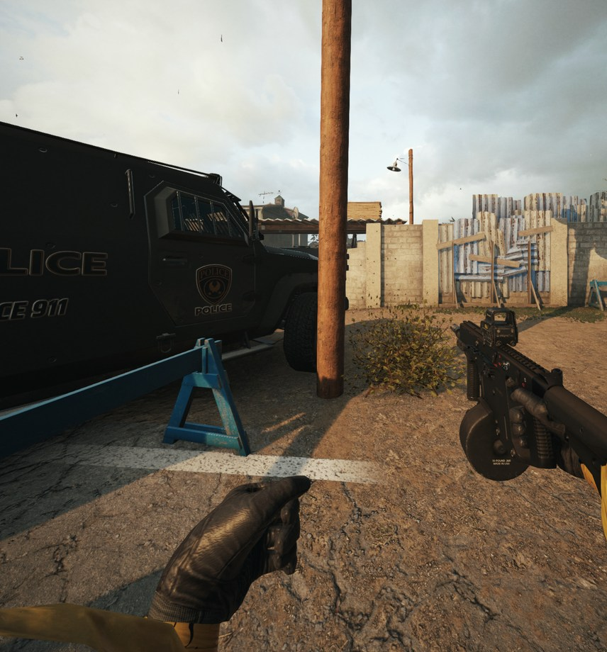
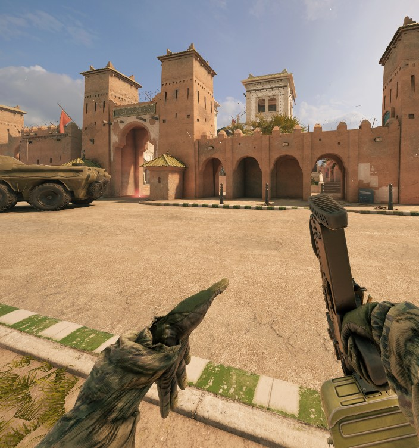

> [!IMPORTANT]
> **DOWNLOAD & DISCUSSION**
>
> **[Join the Flat2VR Discord](https://discord.gg/P4q9zt7ek)** · **[Open the Rainbow Six Siege thread](https://discord.com/channels/747967102895390741/1563409771816550451)**
>
> Get the mod and share feedback in the game’s Flat2VR thread.

  

## Features

**Stereo VR · Tracked weapon aiming · Two-handed foregrip · Stance, vault and gadget controls**

###  Reach for the foregrip to brace your rifle

Grab the front of the gun with your free hand to steady and steer it. Release the grip when you need that hand back.

###  Fire a shot from the tracked muzzle

Point the weapon and pull the trigger. The shot leaves its muzzle and the weapon recoils.

###  Drop prone, vault obstacles and deploy gadgets

Change stance to get behind cover, cross an obstacle with the vault control, then reload or use your operator’s gadget from the controllers.

## Installation

1. Download the [**Throwback Launcher**](https://github.com/xeralin/ThrowbackLauncher) and install **Y5S3 Shadow Legacy (Y5S3.3.1)** with your Steam copy. The [Operation Throwback Discord](https://discord.gg/r6s-operation-throwback-1092820800203141130) has setup help.
2. **Put the mod archive next to `RainbowSix.exe`.** Extract the whole archive there and keep the mod folder intact.
3. Connect PC VR, run **`RUN.bat`** from the extracted mod folder, and enter **Local Training Grounds**.

## In-game screenshots

  
  

[Tester credits](TESTERS.md)

## Other VR mods

| VR mod | Highlights |
| --- | --- |
| [Alone in the Dark (2008) VR](https://github.com/Monsterdeadwood/AloneInTheDark2008VR) | Sweep a flashlight across the room, then grab a chair and carry it by hand. |
| [Battlefield 3: VRevamp](https://github.com/Monsterdeadwood/Battlefield-3-VRevamp) | Pull a dropped enemy rifle toward you, take it with your other hand and fire. |
| [Burnout Paradise Remastered VR](https://github.com/Monsterdeadwood/BUrnOutPvr) | Look into a corner, drift through it and hit boost as you straighten out. |
| [Crysis 2: VRevamp](https://github.com/Monsterdeadwood/C2VR) | Lift an enemy with your free hand and fling them across the room with a swing. |
| [NOVA · CS:GO Legacy VR](https://github.com/Monsterdeadwood/CSGOVR) | Bring the AWP’s scope up to your eye and feel the kick when you shoot. |
| [Metro 2033 VR](https://github.com/Monsterdeadwood/Metro2033VR) | Ricochet a glowing power core down a tunnel and watch it light the walls as it travels. |
| [Star Wars: The Force Unleashed II VR](https://github.com/Monsterdeadwood/TFU2VR) | Hold a Stormtrooper in the air with the Force and swing a lightsaber with your other hand. |
| [TimeShift VR](https://github.com/Monsterdeadwood/TimeShiftVR) | Let go of the foregrip for a quick punch, or strike with the rifle itself. |
| [Titanfall 1 VR](https://github.com/Monsterdeadwood/Titanfall1VR) | Call down a Titan, climb in and send captured shots back with the Vortex Shield. |
| [You Are Empty: Absolute Edition VR](https://github.com/Monsterdeadwood/YouAreEmptyAEVR) | Keep your gun trained ahead with your right hand and strike with your free left. |
