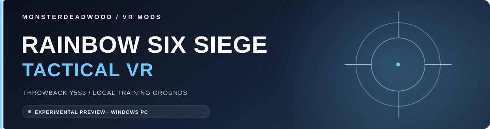

> [!IMPORTANT]
> **[ТЕСТИРОВАНИЕ И ОБСУЖДЕНИЕ · FLAT2VR DISCORD](https://discord.gg/P4q9zt7ek)**
> Тестирование, запрос сборок, отзывы и обсуждение проходят в **Flat2VR Modding Discord**. Перейди на сервер и найди тему **Rainbow Six Siege VR**.

# Rainbow Six Siege VR

[English](README.md) · [Русский](README_RU.md) · [Flat2VR Discord](https://discord.gg/P4q9zt7ek) · [All projects](PORTFOLIO.md)

Экспериментальный VR-мод поддерживаемой PC-сборки Throwback Y5S3 Shadow Legacy / Y5S3.3.1. Текущий маршрут тестирования — локальные Training Grounds, стереообзор, управление контроллерами и двуручное удержание оружия.

**Текущая описанная ветка: R51 handling package / R202 development revision.**

## Установка

**Зайди в [Discord Operation Throwback](https://discord.gg/r6s-operation-throwback-1092820800203141130)** — там помогут с загрузкой и установкой сезона и лаунчером Throwback.

| Компонент | Скачать / источник | Версия / выбор |
| --- | --- | --- |
| **Throwback launcher** | [ThrowbackLauncher.exe — скачать](https://github.com/xeralin/ThrowbackLauncher/releases/download/v0.2.2/ThrowbackLauncher.exe) · [страница версии](https://github.com/xeralin/ThrowbackLauncher/releases/tag/v0.2.2) | Общественный лаунчер xeralin; файл версии v0.2.2 проверен по данным upstream 14 ноября 2026. |
| **Game season** | Получи игровые файлы через лаунчер со своим Steam-аккаунтом, на котором есть Rainbow Six Siege. | Выбери **Y5S3 Shadow Legacy**. VR-пакет рассчитан на поддерживаемые идентификаторы файлов **Y5S3.3.1**. |
| **VR test package** | [Запросить SIEGE_R51_HANDLING на Flat2VR](https://discord.gg/P4q9zt7ek) | VR-пакет скачивается отдельно от общественного лаунчера и файлов сезона. |

1. Скачай и запусти **ThrowbackLauncher.exe** из upstream-версии по ссылке выше. Исходный проект — [xeralin/ThrowbackLauncher](https://github.com/xeralin/ThrowbackLauncher).
2. Используй свой Steam-аккаунт с Rainbow Six Siege и выбери в лаунчере **Y5S3 Shadow Legacy**. Храни эту старую версию в отдельной игровой папке.
3. Проверь, что это поддерживаемый вариант **Y5S3.3.1** и обычная локальная игра запускается, затем закрой её. VR-запуск проверяет поддерживаемые файлы; одного названия сезона недостаточно для совместимости.
4. Возьми полный VR-пакет **SIEGE_R51_HANDLING** в теме Siege на Flat2VR. Найди **RainbowSix.exe** в установленном сезоне и распакуй рядом с ним целую папку мода.
5. Подключи и активируй PC VR, затем открой **RUN.bat** в папке VR обычным способом. Оставь консоль открытой. Обычная кнопка запуска Throwback не является входом в VR.
6. Войди в **LOCAL Training Grounds** клавиатурой/мышью; VR-стерео включится в игре. После теста закрой игру или нажми Ctrl+C в окне запуска и пришли **SEND_THIS_LOGS.zip** в тему Discord.

Доступность актуальных тестовых пакетов уточняется в Discord. Нужен полный пакет для поддерживаемой версии игры; страница проекта сама по себе не является скачиваемым релизом.

## Что есть в проекте

- OpenXR-стерео, зеркало завершённого левого глаза и ширина глаза 2200 пикселей в текущем кандидате.
- Оружие/руки от контроллеров и исправленная композиция вложенных креплений.
- Поддержка второй рукой у родного цевья или выбранной точки поддержки.
- Приседание/лёжа, штатные контекстные действия, перезарядка и отдельные кнопки гаджетов.
- Необязательная проверяемая калибровка HANDLING.json для текущего кандидата.

<b>Краткое управление</b>

| Действие / кнопка | Назначение |
| --- | --- |
| Left stick / click | Движение / переключить бег |
| Right stick horizontal / click | Поворот / ближний бой |
| Right stick up / down | Вторичный гаджет / счёт |
| Right trigger / right grip | Штатный огонь или активация / перезарядка |
| Left trigger / left grip | Основной гаджет / поддерживающая рука |
| X / Y | Взаимодействие / смена оружия |
| A / B tap / B hold | Контекстный перелезть-подняться-спуститься / присесть / лечь |
| Left Menu | Сброс камеры |

Полная инструкция управления в конкретной сборке учитывает её версию и профиль контроллеров.

## Текущий статус

**Экспериментальная сборка.** Для запуска R201 есть подтверждённое тестером изображение Steam Frame/SteamVR на RX 9070 XT. Это не проверка всех шлемов.

- Новому удержанию нужна проверка в физическом шлеме. Сетки прицелов, коллизия щита, покрытие гаджетов и видимость близких объектов ещё в работе.
- Ручные магазины, все операторы и наборы оружия, принятие FPS на железе и многопользовательская LAN-проверка не подтверждены.

[Подробный статус и область проверки](docs/PROJECT_STATUS.md)

## Тестирование и отзывы

Напиши в [тему игры на Flat2VR](https://discord.gg/P4q9zt7ek): укажи **версию мода, игру/магазин, шлем, OpenXR runtime, GPU, шаги воспроизведения и диагностический ZIP сборки**. Для проблем изображения или управления полезно короткое видео.

## Другие мои VR-моды

| Игра / проект | Направление | Доступ |
| --- | --- | --- |
| [Assassin’s Creed VR](https://github.com/Monsterdeadwood/AC1VR) | Обзор от первого лица, лазание и меч | Закрытый |
| [Crysis 2: VRevamp](https://github.com/Monsterdeadwood/C2VR) | Нанокостюм, физическое взаимодействие и интерфейс | Открытый |
| [Star Wars: The Force Unleashed II VR](https://github.com/Monsterdeadwood/TFU2VR) | Два световых меча, телекинез каждой рукой и Сила | Открытый |
| [NOVA · CS:GO Legacy VR](https://github.com/Monsterdeadwood/CSGOVR) | Локальные матчи CS:GO Legacy с VR-управлением | Открытый |
| [TimeShift VR](https://github.com/Monsterdeadwood/TimeShiftVR) | Управление временем, девять видов оружия и позы | Открытый |
| [You Are Empty: Absolute Edition VR](https://github.com/Monsterdeadwood/YouAreEmptyAEVR) | Absolute Edition в VR, оружие и взаимодействие | Открытый |
| [Alone in the Dark 2008 VR](https://github.com/Monsterdeadwood/AloneInTheDark2008VR) | VR-хоррор и взаимодействие с предметами | Открытый |
| [Burnout Paradise Remastered VR](https://github.com/Monsterdeadwood/BUrnOutPvr) | Стереовождение, меню автомобилей и эффекты | Открытый |
| [Titanfall 1 VR](https://github.com/Monsterdeadwood/Titanfall1VR) | Бой пилота и кабины титанов | Открытый |
| [Metro 2033 VR](https://github.com/Monsterdeadwood/Metro2033VR) | Оригинальная Metro в VR и нативная физика | Открытый |
| [Insurgency VR](https://github.com/Monsterdeadwood/InsurgencyVR) | Начальная подготовка VR-интеграции | Закрытый |
| [Counter-Strike: Source VR](https://github.com/Monsterdeadwood/CSSVR) | Разработка VR для Counter-Strike: Source | Закрытый |

Ссылки на закрытые репозитории доступны приглашённым участникам. Открытые страницы отмечены в таблице.

## Авторство и заметки разработки

Проект ведёт [Monsterdeadwood](https://github.com/Monsterdeadwood). Это независимый фанатский VR-проект; нужна собственная поддерживаемая копия оригинальной игры.

Описание сверено: **14 ноября 2026 года**.
